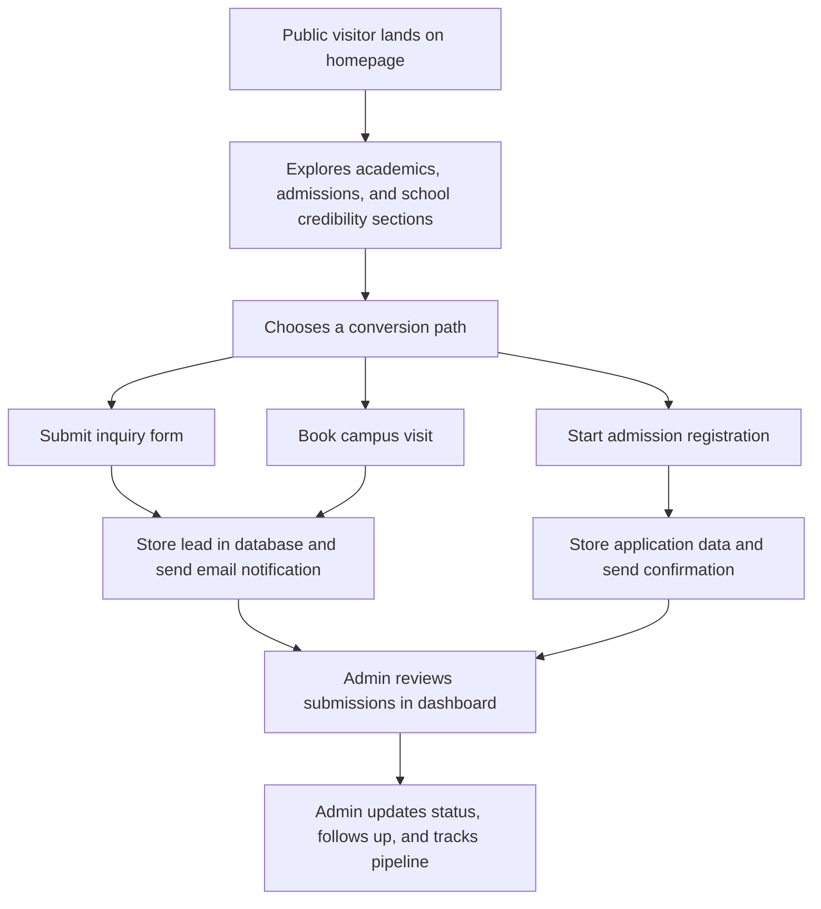

## 1. Product Overview
Sanjivani International School needs a premium, production-grade website that positions the school as a top-tier academic institution while turning admissions interest into completed inquiries, campus visits, and registration starts.
- The platform serves prospective parents, current parents, students, alumni, faculty applicants, and internal content managers through a fast, polished, accessible, CMS-driven experience.
- The primary business value is admissions growth; the secondary value is institutional trust, operational efficiency, and stronger communication across all stakeholder groups.

## 2. Core Features

### 2.1 User Roles
| Role | Registration Method | Core Permissions |
|------|---------------------|------------------|
| Public | No registration | Browse public pages, submit inquiries, book visits, apply for admissions, access public downloads |
| Admin | Seeded or invited account | Full dashboard access, user/role management, content management, analytics, logs, settings |
| Editor | Invited account | Manage assigned CMS content such as news, gallery, static pages, downloads, faculty, announcements |

### 2.2 Feature Module
1. **Global Experience**: sticky header, mega menu, search entry point, breadcrumbs, announcement ticker, footer, SEO metadata, analytics hooks
2. **Homepage**: premium hero, admissions CTAs, counters, school highlights, principal welcome, announcements, achievements preview
3. **About**: history, vision, mission, values, leadership, infrastructure summary, accreditations, downloadable documents
4. **Academics**: reusable academic level template driven by structured data for Pre-Primary through Senior Secondary
5. **Admissions**: process, eligibility, timeline, fee structure, FAQs, inquiry form, campus visit booking, multi-step registration flow
6. **Faculty**: filterable faculty directory, teacher profiles, professional development, careers linkage
7. **Student Life**: co-curricular programs, clubs, leadership, community service, annual events
8. **Infrastructure**: media-backed campus facilities pages using reusable gallery and detail layouts
9. **Gallery**: category-filterable image/video grid with pagination and optimized media loading
10. **News & Events**: CMS-backed news, events, circulars, archive, categories, and search
11. **Achievements**: showcase grid for academic, sports, Olympiad, and faculty recognition
12. **Parent Corner**: downloads, circulars, schedules, portal links, support forms, FAQs
13. **Student Corner**: assignments links, exam schedule, results links, resources, competitions, handbook
14. **Alumni**: registration, testimonials, success stories, event highlights, network details
15. **Careers**: openings, benefits, recruitment process, online application with resume upload
16. **Policy Pages**: CMS-editable legal and institutional policy content
17. **Contact**: map, contact cards, social links, departmental contacts, inquiry form
18. **Admin Dashboard**: role-based management for content, admissions leads, files, SEO, logs, users, analytics overview

### 2.3 Page Details
| Page Name | Module Name | Feature Description |
|-----------|-------------|---------------------|
| Home | Hero Banner | Full-width media area with headline, academic excellence messaging, and primary CTAs |
| Home | Announcement Ticker | Auto-scrolling announcements with CMS-managed items |
| Home | Quick Stats | Animated counters for school impact metrics with accessible reduced-motion fallback |
| Home | Principal Welcome | Introductory leadership message with CTA to full About content |
| About | Institution Story | History, mission, vision, values, and leadership content blocks |
| About | Downloads | Prospectus, profile PDF, academic calendar, and accreditations |
| Academics | AcademicLevelTemplate | Reusable template fed from structured content for all academic stages |
| Admissions | Inquiry Form | High-conversion inquiry form with validation, email notifications, and spam protection |
| Admissions | Campus Visit Booking | Date/time preference capture with status tracking |
| Admissions | Registration Form | Multi-step admission workflow with progress indicator, draft-safe UX, and confirmation state |
| Faculty | Directory | Department filters, profile cards, qualification summaries |
| Student Life | Activities Showcase | Structured sections for clubs, sports, arts, leadership, excursions, and service |
| Infrastructure | Facility Detail Pages | Reusable content + gallery layout for classrooms, labs, library, sports, transport, and safety |
| Gallery | Filterable Grid | Category filters, image/video support, lightbox-ready interactions |
| News & Events | CMS Feed | Search, categories, featured items, archive, and upcoming events listing |
| Achievements | Recognition Grid | Student and faculty achievements grouped by category and year |
| Parent Corner | Service Hub | Circulars, portal links, transport info, schedule info, FAQs, and feedback forms |
| Student Corner | Resource Hub | Learning resource links, exam schedule, assignments links, and handbook downloads |
| Alumni | Registration + Stories | Alumni onboarding, testimonials, event listing, and network messaging |
| Careers | Hiring Flow | Openings list, application form, resume upload, benefits, and process overview |
| Contact | Inquiry Hub | Contact cards, map embed, departmental contacts, social links, inquiry form |
| Admin Dashboard | Analytics Overview | Lead counts, content activity, recent submissions, top-performing sections |
| Admin Dashboard | CMS Modules | CRUD for news, gallery, faculty, announcements, downloads, static pages, and admissions records |

## 3. Core Process
Primary journeys focus on discovery, trust-building, and conversion into admissions actions. Public users should be able to understand the school's value quickly, explore academics and infrastructure, then submit either an inquiry, campus visit request, or admission registration. Admin and Editor users should manage all public content and incoming leads from a secure dashboard without requiring developer intervention for routine updates.

## 4. User Interface Design
### 4.1 Design Style
- Visual direction: premium academic editorial with restrained luxury, strong typography, warm-neutral surfaces, deep institutional blues, and subtle gold accents
- Brand posture: "Academic Excellence" should feel confident, calm, rigorous, and future-facing
- Button style: rounded rectangular buttons with strong contrast, generous horizontal padding, and elevated hover states
- Card style: rounded 24px panels, soft shadowing, thin borders, limited glassmorphism only in hero overlays and announcement surfaces
- Typography approach: distinguished serif display paired with a highly readable sans-serif body family
- Layout style: desktop-first composition with generous spacing, asymmetric highlights, clear section rhythm, and mobile-friendly stacking
- Motion approach: sparse Framer Motion reveals for hero, counters, and selected section entrances only; reduced-motion support is required
- Icon style: clean, outlined, institution-appropriate icons with no cartoon styling

### 4.2 Page Design Overview
| Page Name | Module Name | UI Elements |
|-----------|-------------|-------------|
| Global | Header and Footer | Sticky navigation, mega-menu, search trigger, portal shortcuts, structured footer navigation |
| Home | Hero | Layered media, premium copy hierarchy, glass accent panel, CTA group |
| Home | Stats + Highlights | Large numeric counters, editorial grid, restrained reveal motion |
| About | Leadership + Values | Two-column content, pull quotes, image-backed message cards |
| Academics | Level Template | Structured tabbed or sectional layout, curriculum blocks, support modules |
| Admissions | Forms | Multi-step form cards, progress tracker, validation helpers, toast confirmations |
| Faculty | Directory | Search/filter bar, responsive card grid, profile metadata tags |
| Infrastructure | Facility Pages | Large media headers, modular content sections, gallery strips |
| Gallery | Media Grid | Masonry-like balance with category chips and optimized thumbnails |
| News & Events | Content Feed | Featured article layout, cards, filters, archive controls |
| Dashboard | Admin UI | Dense, efficient panels, data tables, status badges, activity streams |

### 4.3 Responsiveness
- Desktop-first design, optimized down through tablet and mobile breakpoints
- Touch-friendly controls for nav, filters, forms, and media galleries
- Sticky and mega-menu behavior must simplify gracefully on smaller screens
- All tables, dashboards, and filter interfaces must degrade into stacked or drawer-based mobile patterns

## 5. Phase Plan
### Phase 0 - Foundation
- Initialize Next.js App Router project with TypeScript, Tailwind CSS, and shadcn/ui
- Establish design system tokens for color, typography, spacing, radius, shadows, motion, and layout containers
- Build global shell: header, mega menu, footer, app layout, metadata baseline
- Create reusable UI building blocks: Button, Card, Section, FormField, Modal, Tabs, Accordion, Counter, GalleryGrid, Toast
- Prepare central site configuration for branding, navigation, contact info, and social links

### Phase 1 - Core Public Pages
- Homepage
- About page
- Contact page with working inquiry form, validation, persistence, and email notification

### Phase 2 - Admissions
- Admissions content architecture
- Multi-step inquiry and registration flows
- Campus visit booking
- Backend schema and APIs for inquiries and applications

### Phase 3 - Academic and Institutional Sections
- Academics
- Faculty
- Student Life
- Infrastructure

### Phase 4 - Content Hubs
- Gallery
- News & Events
- Achievements

### Phase 5 - Community and Policy Areas
- Parent Corner
- Student Corner
- Alumni
- Careers
- Policy pages

### Phase 6 - Admin Dashboard
- Authentication and role-based access
- CMS CRUD modules
- Admissions management
- Analytics overview

### Phase 7 - Hardening
- Security pass
- SEO pass
- Performance pass
- Accessibility audit

## 6. Phase 0 Decisions Proposed for Approval
1. Use Next.js route handlers instead of a separate Express server for this scope to reduce deployment and maintenance complexity while keeping REST-style APIs.
2. Use Prisma with PostgreSQL from the start, even in Phase 0, so data models and forms can be added incrementally without restructuring.
3. Use a central content/config layer for brand data, navigation, and placeholder institutional content until CMS modules are introduced in later phases.
4. Use a refined editorial design system with a serif display font and sans-serif body font to differentiate the site from generic school templates.
