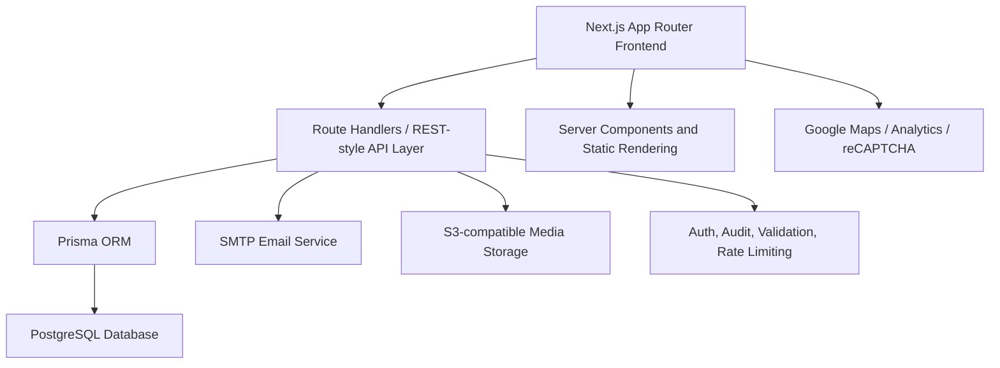
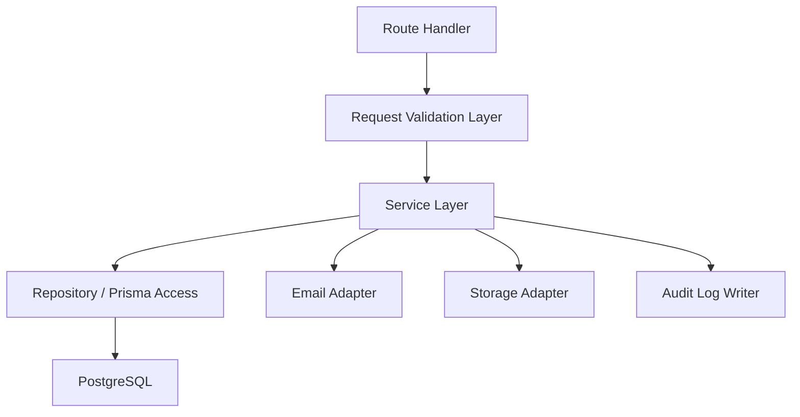
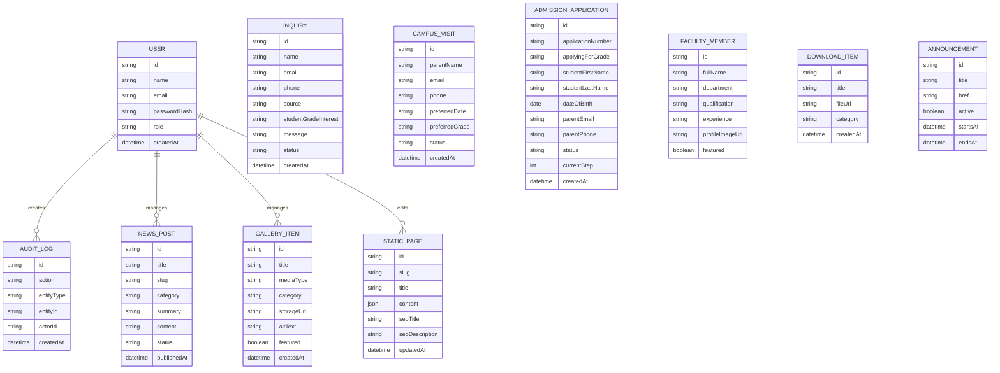

## 1. Architecture Design



## 2. Technology Description
- Frontend: Next.js 15 App Router + React 19 + TypeScript
- Styling: Tailwind CSS + CSS variables for design tokens
- Component Foundation: shadcn/ui
- Motion: Framer Motion, used sparingly and guarded by reduced-motion preferences
- Backend: Next.js route handlers following REST-style resource design
- Database: PostgreSQL + Prisma ORM
- File Storage: S3-compatible object storage for uploads and optimized media handling
- Email: SMTP for inquiry, admissions, and career application notifications
- Auth: secure role-based authentication using hashed credentials and httpOnly session or JWT cookie strategy
- Validation: Zod on both client and server
- Forms and UX feedback: React Hook Form + toast system + skeleton loading states
- Monitoring and analytics: Google Analytics, structured server logging, and admin audit log persistence

## 3. Route Definitions
| Route | Purpose |
|-------|---------|
| `/` | Homepage with admissions-first storytelling and conversion entry points |
| `/about` | Institutional history, values, leadership, downloads, accreditations |
| `/academics` | Academic overview and entry point to level-specific content |
| `/academics/[level]` | Reusable academic level detail pages driven by structured data |
| `/admissions` | Admissions overview, process, eligibility, FAQ, fee and timeline information |
| `/faculty` | Filterable faculty directory and academic team messaging |
| `/student-life` | Activities, clubs, sports, arts, leadership, service programs |
| `/infrastructure` | Campus infrastructure overview |
| `/infrastructure/[facility]` | Facility-specific content pages with gallery-backed layouts |
| `/gallery` | Filterable gallery and media browsing |
| `/news-events` | News, events, circulars, categories, archive |
| `/achievements` | Student and faculty achievement showcase |
| `/parent-corner` | Parent service and information hub |
| `/student-corner` | Student resources and links hub |
| `/alumni` | Alumni registration, stories, and event information |
| `/careers` | Job openings and application flow |
| `/contact` | Contact details, map, departmental contacts, inquiry form |
| `/policies/[slug]` | CMS-editable policy pages |
| `/admin` | Secure dashboard shell |
| `/admin/*` | Authenticated management modules for CMS, users, admissions, SEO, logs, settings |

## 4. API Definitions
### 4.1 Public API Surface
| Method | Route | Purpose |
|--------|-------|---------|
| `POST` | `/api/inquiries` | Submit general contact or admissions inquiry |
| `POST` | `/api/campus-visits` | Submit campus visit request |
| `POST` | `/api/admission-applications` | Submit or update multi-step registration flow |
| `POST` | `/api/careers/applications` | Submit career application with resume upload |
| `GET` | `/api/news` | Fetch public news and event listing with filters |
| `GET` | `/api/gallery` | Fetch public gallery media by category |
| `GET` | `/api/faculty` | Fetch public faculty directory data |
| `GET` | `/api/announcements` | Fetch active announcements for global surfaces |

### 4.2 Admin API Surface
| Method | Route | Purpose |
|--------|-------|---------|
| `POST` | `/api/auth/login` | Authenticate admin or editor |
| `POST` | `/api/auth/logout` | End session |
| `GET` | `/api/admin/dashboard` | Fetch analytics summary and recent activity |
| `GET/POST/PATCH/DELETE` | `/api/admin/news` | Manage news and events |
| `GET/POST/PATCH/DELETE` | `/api/admin/gallery` | Manage media assets and categories |
| `GET/POST/PATCH/DELETE` | `/api/admin/faculty` | Manage faculty profiles |
| `GET/POST/PATCH/DELETE` | `/api/admin/downloads` | Manage downloadable files |
| `GET/POST/PATCH/DELETE` | `/api/admin/pages` | Manage editable static page content |
| `GET/PATCH` | `/api/admin/admission-applications` | Review and update admission pipeline statuses |
| `GET/PATCH` | `/api/admin/inquiries` | Review and manage inquiry submissions |
| `GET/POST/PATCH/DELETE` | `/api/admin/users` | Manage roles and staff accounts |
| `GET` | `/api/admin/logs` | View audit logs and system activity |

### 4.3 Type Definitions
```ts
type UserRole = "ADMIN" | "EDITOR";

type InquiryPayload = {
  name: string;
  email: string;
  phone: string;
  studentGradeInterest?: string;
  message: string;
  source: "CONTACT" | "ADMISSIONS";
};

type CampusVisitPayload = {
  parentName: string;
  email: string;
  phone: string;
  studentName?: string;
  preferredGrade?: string;
  preferredDate: string;
  notes?: string;
};

type AdmissionApplicationPayload = {
  applicationId?: string;
  step: number;
  student: {
    firstName: string;
    lastName: string;
    dateOfBirth: string;
    applyingForGrade: string;
  };
  parents: {
    fatherName?: string;
    motherName?: string;
    guardianName?: string;
    email: string;
    phone: string;
  };
  documents?: {
    birthCertificateUrl?: string;
    transferCertificateUrl?: string;
    reportCards?: string[];
  };
  status?: "DRAFT" | "SUBMITTED";
};
```

## 5. Server Architecture Diagram



## 6. Data Model
### 6.1 Data Model Definition



### 6.2 Data Definition Language
```sql
CREATE TABLE users (
  id UUID PRIMARY KEY,
  name VARCHAR(120) NOT NULL,
  email VARCHAR(180) NOT NULL UNIQUE,
  password_hash TEXT NOT NULL,
  role VARCHAR(20) NOT NULL,
  created_at TIMESTAMP NOT NULL DEFAULT NOW()
);

CREATE TABLE inquiries (
  id UUID PRIMARY KEY,
  name VARCHAR(120) NOT NULL,
  email VARCHAR(180) NOT NULL,
  phone VARCHAR(30) NOT NULL,
  source VARCHAR(20) NOT NULL,
  student_grade_interest VARCHAR(40),
  message TEXT NOT NULL,
  status VARCHAR(20) NOT NULL DEFAULT 'NEW',
  created_at TIMESTAMP NOT NULL DEFAULT NOW()
);

CREATE INDEX idx_inquiries_created_at ON inquiries (created_at DESC);
CREATE INDEX idx_inquiries_source_status ON inquiries (source, status);

CREATE TABLE campus_visits (
  id UUID PRIMARY KEY,
  parent_name VARCHAR(120) NOT NULL,
  email VARCHAR(180) NOT NULL,
  phone VARCHAR(30) NOT NULL,
  preferred_date TIMESTAMP NOT NULL,
  preferred_grade VARCHAR(40),
  status VARCHAR(20) NOT NULL DEFAULT 'NEW',
  created_at TIMESTAMP NOT NULL DEFAULT NOW()
);

CREATE INDEX idx_campus_visits_preferred_date ON campus_visits (preferred_date);

CREATE TABLE admission_applications (
  id UUID PRIMARY KEY,
  application_number VARCHAR(40) NOT NULL UNIQUE,
  applying_for_grade VARCHAR(40) NOT NULL,
  student_first_name VARCHAR(80) NOT NULL,
  student_last_name VARCHAR(80) NOT NULL,
  date_of_birth DATE NOT NULL,
  parent_email VARCHAR(180) NOT NULL,
  parent_phone VARCHAR(30) NOT NULL,
  current_step INT NOT NULL DEFAULT 1,
  status VARCHAR(20) NOT NULL DEFAULT 'DRAFT',
  created_at TIMESTAMP NOT NULL DEFAULT NOW()
);

CREATE INDEX idx_admission_applications_status_created_at ON admission_applications (status, created_at DESC);

CREATE TABLE news_posts (
  id UUID PRIMARY KEY,
  title VARCHAR(220) NOT NULL,
  slug VARCHAR(240) NOT NULL UNIQUE,
  category VARCHAR(60) NOT NULL,
  summary TEXT NOT NULL,
  content TEXT NOT NULL,
  status VARCHAR(20) NOT NULL DEFAULT 'DRAFT',
  published_at TIMESTAMP
);

CREATE INDEX idx_news_posts_category_published_at ON news_posts (category, published_at DESC);

CREATE TABLE gallery_items (
  id UUID PRIMARY KEY,
  title VARCHAR(220) NOT NULL,
  media_type VARCHAR(20) NOT NULL,
  category VARCHAR(60) NOT NULL,
  storage_url TEXT NOT NULL,
  alt_text VARCHAR(240) NOT NULL,
  featured BOOLEAN NOT NULL DEFAULT FALSE,
  created_at TIMESTAMP NOT NULL DEFAULT NOW()
);

CREATE INDEX idx_gallery_items_category_created_at ON gallery_items (category, created_at DESC);
```

## 7. Proposed Folder Structure
```text
src/
  app/
    (public)/
      page.tsx
      about/page.tsx
      academics/page.tsx
      academics/[level]/page.tsx
      admissions/page.tsx
      faculty/page.tsx
      student-life/page.tsx
      infrastructure/page.tsx
      infrastructure/[facility]/page.tsx
      gallery/page.tsx
      news-events/page.tsx
      achievements/page.tsx
      parent-corner/page.tsx
      student-corner/page.tsx
      alumni/page.tsx
      careers/page.tsx
      contact/page.tsx
      policies/[slug]/page.tsx
    admin/
      layout.tsx
      login/page.tsx
      page.tsx
      admissions/page.tsx
      content/page.tsx
      users/page.tsx
      settings/page.tsx
    api/
      inquiries/route.ts
      campus-visits/route.ts
      admission-applications/route.ts
      careers/applications/route.ts
      auth/login/route.ts
      auth/logout/route.ts
      admin/...
    layout.tsx
    sitemap.ts
    robots.ts
  components/
    ui/
    layout/
    navigation/
    forms/
    sections/
    gallery/
    dashboard/
  content/
    site-config.ts
    navigation.ts
    homepage.ts
    academics.ts
    infrastructure.ts
    policies.ts
  lib/
    auth/
    db/
    email/
    storage/
    seo/
    analytics/
    validations/
    utils/
  hooks/
  types/
  styles/
prisma/
  schema.prisma
  migrations/
public/
  images/
  icons/
```

## 8. Phase 0 Design Tokens Proposal
### 8.1 Color System
| Token | Value | Purpose |
|-------|-------|---------|
| `--color-primary-900` | `#10233F` | Deep institutional navy for headers, footer, and primary text anchors |
| `--color-primary-700` | `#1D3A63` | Primary action surfaces and emphasis |
| `--color-primary-500` | `#2F5D8A` | Interactive highlights and secondary brand surfaces |
| `--color-accent-500` | `#B9924C` | Premium academic gold accent for dividers, badges, and subtle emphasis |
| `--color-accent-100` | `#F2E7D3` | Soft accent wash backgrounds |
| `--color-surface-0` | `#FCFBF8` | Main page background |
| `--color-surface-50` | `#F4F0E8` | Alternate section background |
| `--color-surface-100` | `#E8E0D2` | Borders and muted panels |
| `--color-ink-900` | `#171717` | Primary body text |
| `--color-ink-700` | `#4A4A4A` | Secondary body text |
| `--color-success-500` | `#1F7A4C` | Success feedback |
| `--color-warning-500` | `#A06A17` | Alerts and pending states |
| `--color-danger-500` | `#B33A3A` | Errors and destructive actions |

### 8.2 Typography
| Token | Proposal | Usage |
|-------|----------|-------|
| `font-display` | `"Cormorant Garamond", serif` | Hero headlines, section titles, editorial quotes |
| `font-body` | `"Manrope", sans-serif` | Body copy, nav, UI, forms, dashboard |
| `text-display-xl` | `clamp(3.5rem, 7vw, 6rem)` | Homepage hero headline |
| `text-display-lg` | `clamp(2.5rem, 5vw, 4rem)` | Major section headers |
| `text-heading-xl` | `clamp(2rem, 4vw, 3rem)` | Page titles |
| `text-heading-lg` | `clamp(1.5rem, 3vw, 2.25rem)` | Subsection titles |
| `text-body-lg` | `1.125rem` | Intro paragraphs |
| `text-body` | `1rem` | Standard content |
| `text-caption` | `0.875rem` | Labels, metadata, helper copy |

### 8.3 Spacing and Radius
| Token | Value |
|-------|-------|
| `space-2` | `0.5rem` |
| `space-3` | `0.75rem` |
| `space-4` | `1rem` |
| `space-6` | `1.5rem` |
| `space-8` | `2rem` |
| `space-12` | `3rem` |
| `space-16` | `4rem` |
| `space-24` | `6rem` |
| `radius-sm` | `0.75rem` |
| `radius-md` | `1rem` |
| `radius-lg` | `1.5rem` |
| `radius-xl` | `2rem` |

### 8.4 Shadows and Motion
| Token | Value | Usage |
|-------|-------|-------|
| `shadow-soft` | `0 10px 30px rgba(16, 35, 63, 0.08)` | Standard cards |
| `shadow-elevated` | `0 20px 50px rgba(16, 35, 63, 0.14)` | Hero panels, featured surfaces |
| `duration-fast` | `180ms` | Hover states |
| `duration-base` | `280ms` | Standard transitions |
| `duration-slow` | `480ms` | Premium reveal moments |

## 9. Implementation Strategy for Phase 0
1. Scaffold the app and configure Tailwind, shadcn/ui, Prisma, and base tooling.
2. Create global design tokens in CSS variables and Tailwind theme extensions.
3. Build the root layout, sticky header, mega menu shell, footer, and site configuration layer.
4. Implement reusable UI components required by later phases.
5. Add placeholder routes only where necessary to validate the information architecture without building full page content yet.

## 10. Open Decisions for User Review
1. Recommended font pairing is `Cormorant Garamond` + `Manrope`; approve or replace with brand-approved typography if available.
2. Recommended palette uses deep navy plus muted gold; approve or replace once official school brand colors are supplied.
3. Recommended API strategy is Next.js route handlers rather than a separate Express service for faster phase delivery.
